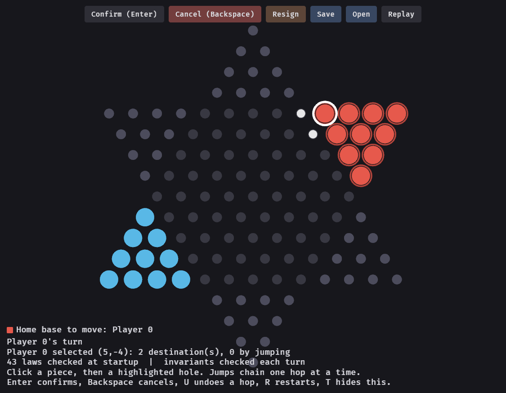
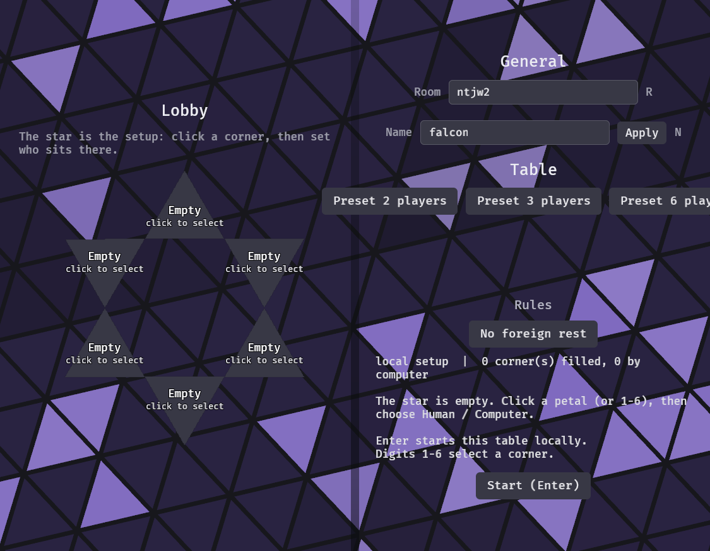

# Chinese Checkers, in Rust

A Chinese Checkers game whose rules are **generated from a formal specification**
and checked three ways — machine-verified laws, Kani proofs, and a per-turn
invariant audit — with a Bevy front-end that holds no rules of its own. Every
destination a player can click is *found* by the rules engine; there is no code
path to an illegal position.



## Play

```sh
cargo run -p checkers-bevy
```

Pick a table in the lobby — solo against the engine, hotseat, or a shared room
over WebRTC — then click a piece and a highlighted hole. Steps and jumps both
**stage** before they commit; a jump chains one hop at a time, and nothing is
final until Enter. Every turn is replayed as an animation, the lobby sits on a
living Game-of-Life triangle field, and the lobby's buttons, text fields, and
room roster work over the wire.



| Input | Effect |
|---|---|
| Click piece, click hole | Select, then stage a step or a hop |
| Enter / Backspace | Commit or abandon the staged turn |
| U | Undo one staged hop |
| A | Let the engine play this seat once |
| T / S | Status panel / sound |
| R | Fresh two-player deal (solo) |

## Trusting the rules

The game in `specs/specification.md` is law: numbered, falsifiable statements
that are *transcribed into code* by `checkers-spec-gen` and checked at startup
(`cargo test` runs them all). Position invariants are audited after every
committed move, Kani proofs cover the geometry and turn machinery
(`./scripts/verify-proofs.sh`), and the AI engine is differentially tested
against a naive reference model. A rendered law report is generated for the
project page.

## Driving it as an agent

The window can be operated by a script — no mouse or keyboard of its own. The
game opens a localhost socket speaking JSON: screenshots, clicks, keys, text,
and the full game state. There is no privileged move command; an agent plays
exactly what a hand on the mouse could.

```sh
python3 scripts/agent_client.py --port N demo   # play one move, start to finish
```

See `checkers-bevy/src/agent.rs` for the protocol.

## Workspace

| Crate | Holds |
|---|---|
| `checkers-core` | The rules, the laws, the machine-checked geometry |
| `checkers-ai` | The search engine (bitboards, negamax/maxⁿ) |
| `checkers-net` | The wire protocol and host-sequenced moves |
| `checkers-bevy` | The Bevy front-end and the agent socket |
| `checkers-spec-gen` | Specification → law code, and the staleness gate |

Deeper material lives in `docs/` and `specs/`.
